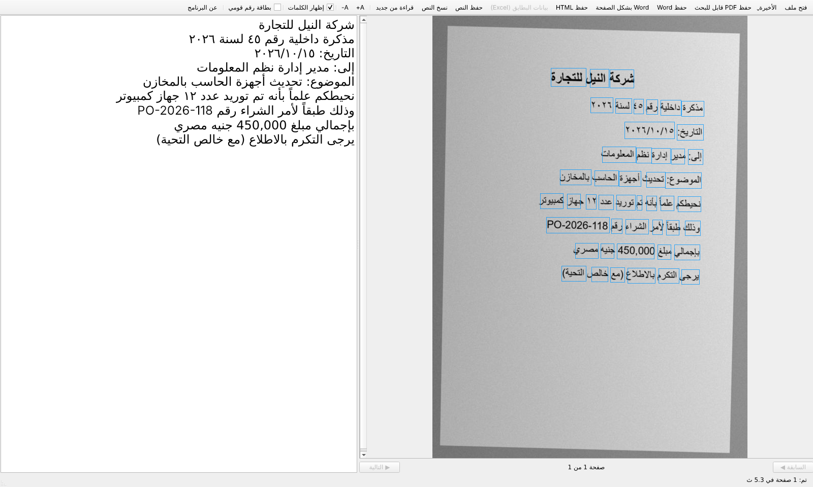
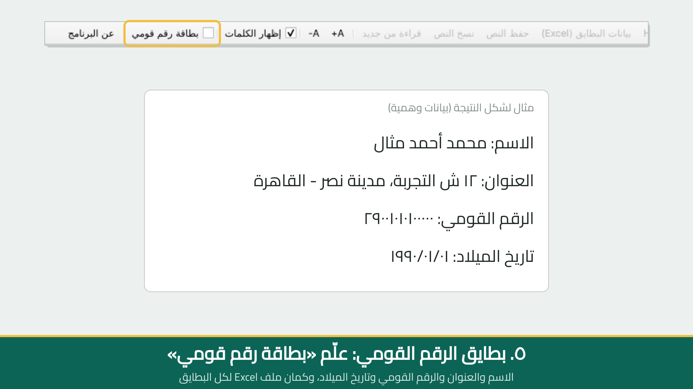

# EGY-OCR — Offline Arabic OCR

Arabic OCR that runs fully offline on an ordinary Windows laptop: scanned books,
office memos, phone photos and Egyptian national ID cards in; searchable PDF,
editable Word, HTML, text and Excel (CSV) out. No cloud and no API key, so documents never
leave the machine.

▶️ [Demo video (42 s)](docs/demo.mp4) · [بالعربي ↓](#بالعربي)

## Features
- **Searchable PDF**: the page image stays as it is, and an invisible text layer is placed word by word on top. Copy, search and select work.
- **Word (.docx)** as normal editable text (paragraphs, headings, right-to-left), or a
  "looks like the scan" layout. **HTML** and **TXT** too.
- **Books**: two-column pages, diacritics (tashkeel), and classic naskh fonts with ligatures and kashida
  (a dedicated recognizer is picked per page automatically).
- **Egyptian national ID cards** (front side): name, first name, address, national ID,
  birth date, sex, governorate and card number → Excel. Every field is read from its own position on
  the card, measured from the title, so a missing field never spills into another
  (the birth date can't end up inside the ID number). The ID is checked: century, date and governorate code.
- **Teach it**: right-click a misread word → «علّم البرنامج التصحيح ده». The fix is
  applied to every later reading (plain text file you can edit).
- **History**: a file read once opens instantly the next time, with your edits.
- Desktop app (PySide6) and a command line; Windows `.exe` build without Python.

## Results (on our test pages)
| | character error rate |
|---|---|
| scanned book pages | 1.5 % |
| office memos (scan / phone photo) | 0.2 % |
| ID cards (22 card photos) | all name, address, ID and birth-date fields correct |

## Install
Python 3.10+:

    pip install -r requirements.txt

## Desktop app
    python app.py            (or double-click run_gui.bat)

Open or drag a PDF or image, see the detected words on the page, fix the text, then save.
Tick **«بطاقة رقم قومي»** for ID cards. `build_exe.bat` builds `dist\EGY-OCR\EGY-OCR.exe`.

## Command line
The Python package is called `arocr`:

    python -m arocr scan.pdf photo.jpg -o out          # searchable PDF + .txt
    python -m arocr book.pdf --docx --html             # also Word and HTML
    python -m arocr cards_folder --id-card             # ID cards -> .cards.csv (Excel)
    python -m pytest tests

## How it works
1. PDF pages rendered with pdfium, or the image is loaded.
2. PP-OCRv5 DB text detector (ONNX Runtime, CPU), plus a second search between lines for short
   words the detector skips on busy backgrounds.
3. Arabic recognizer fine-tuned from PP-OCRv5. Number rows are re-read stretched, and a Latin
   model fills in codes and Western digits.
4. Lines and columns put in reading order, right to left.
5. Text fixes: tanween, «الله», split names, Persian look-alike letters.
6. Output writers: PDF text layer, Word, HTML, CSV.

Fine-tuning scripts and notes: [training/](training/README.md).

## Privacy and responsible use
- Everything runs locally; nothing is uploaded.
- The program **reads** identity documents; it does not alter them. Visible word
  replacement is disabled on ID cards and other official documents.
- Don't commit real ID cards or personal documents to this repository (`private/` is git-ignored for local test files).

## About the author
**Keroles Farouk** — IT Manager with about 15 years in enterprise IT infrastructure
(networks, security, virtualization, ERP), who also builds his own tools in C#/.NET and Python.
EGY-OCR is built to read Arabic documents and ID cards accurately
without sending them to any online service.

- LinkedIn: [Keroles Farouk](https://www.linkedin.com/in/keroles-farouk-6b715424/)

Questions, bugs and ideas: open an [issue](https://github.com/engkerolesfarouk-eng/EGY-OCR/issues). Pull requests are welcome.

## License
Apache License 2.0 — see [LICENSE](LICENSE) and [NOTICE](NOTICE).
The models in `models/` are derived from [PaddleOCR](https://github.com/PaddlePaddle/PaddleOCR)
PP-OCRv5 (Apache 2.0).

---

## بالعربي

برنامج OCR عربي بيشتغل **من غير إنترنت** على أي لابتوب ويندوز عادي. بيقرا الكتب
المتصورة والمذكرات وصور الموبايل وبطايق الرقم القومي المصرية، وبيطلّع PDF تقدر تدوّر
فيه، وWord تقدر تعدّل فيه، وHTML ونص وExcel. الملفات ما بتخرجش من الجهاز.

**أهم المميزات:**
- PDF الصورة فيه زي ما هي، والنص مستخبي فوقها كلمة كلمة، فالنسخ والبحث شغالين.
- Word نص عادي سهل التعديل، أو بشكل الصفحة الأصلية.
- كتب بعمودين، وتشكيل، وخطوط النسخ القديمة.
- **بطاقة الرقم القومي:** الاسم والعنوان والرقم القومي وتاريخ الميلاد في ملف Excel.
  كل بند بيتقرا من مكانه في البطاقة، فلو بند ناقص ما يأثرش على الباقي. والرقم القومي بيتراجع:
  القرن والتاريخ وكود المحافظة.
- **علّم البرنامج:** كليك يمين على الكلمة الغلط، وتكتب الصح، ومن بعدها البرنامج بيصححها لوحده.
- السجل: الملف اللي اتقرا قبل كده بيفتح على طول، بتعديلاتك.

▶️ [فيديو توضيحي](docs/demo.mp4)

**التشغيل:**

    pip install -r requirements.txt
    python app.py

البرنامج **بيقرا** المستندات الرسمية بس، وما بيعدّلش فيها.

**عن المطوّر:** Keroles Farouk، مدير تكنولوجيا معلومات بخبرة حوالي ١٥ سنة في البنية التحتية،
وبيطوّر أدواته بنفسه بـ C#/.NET وPython. البرنامج معمول عشان يقرا المستندات
العربية والبطايق بدقة من غير ما تتبعت لأي خدمة على الإنترنت.
[LinkedIn](https://www.linkedin.com/in/keroles-farouk-6b715424/)
